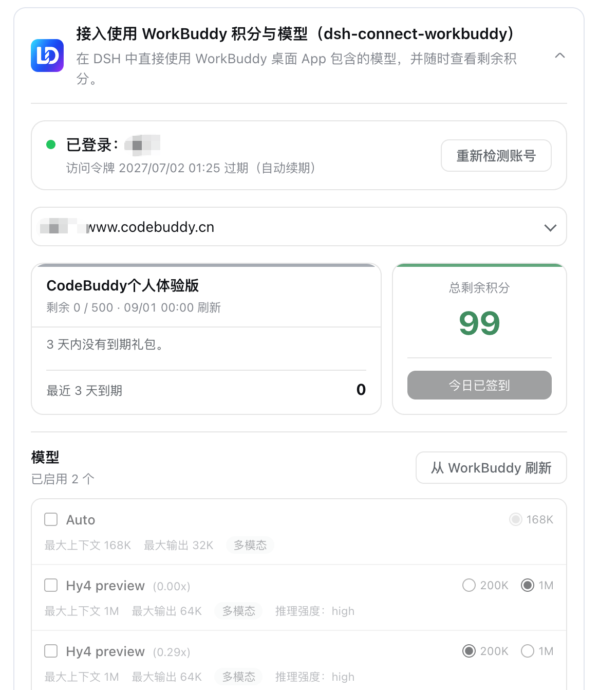

<p align="center">
  
</p>

<h1 align="center">dsh-connect-workbuddy</h1>

<p align="center"><b>把本机登录的 WorkBuddy 模型（国内版与国际版）接入 DeepSeek Harness：每次刷新自动读取积分倍率，逐模型开关图片输入，多账号可切换，并带每日签到与只读积分概览。</b></p>

<p align="center">
  <a href="README.en.md">English</a> ·
  <a href="#文档索引">文档索引</a> ·
  <a href="CHANGELOG.md">更新日志</a> ·
  <a href="https://github.com/dingminhua/dsh-connect-workbuddy/issues">问题反馈</a>
</p>

<p align="center">
  <a href="https://www.npmjs.com/package/dsh-connect-workbuddy"></a>
  <a href="https://www.npmjs.com/package/dsh-connect-workbuddy"></a>
  <a href="https://github.com/dingminhua/dsh-connect-workbuddy/actions/workflows/ci.yml"></a>
  <a href="LICENSE"></a>
  <a href="https://github.com/dingminhua/dsh-connect-workbuddy/stargazers"></a>
  <a href="https://dshfind.com/plugins/dingminhua/dsh-connect-workbuddy"></a>
</p>

## 简介

一个独立的 [DeepSeek Harness (DSH)](https://github.com/deepseek-ai/deepseek-harness) bundle 插件，把本机已登录的 WorkBuddy 账号接到 DSH 的模型选择器。国内版与国际版是两个并行供应商（`workbuddy` / `workbuddy-global`），可同时使用、互不干扰；只需本机 WorkBuddy 登录态，或在浏览器里登录一次。

插件本身不提供账号、不共享凭据、不绕过计费：每次调用都消耗**你自己账号**的额度，按上游给出的倍率真实扣费，插件从不修改账号状态。

## 风险提示

> **WorkBuddy 已开始限制非官方客户端请求。上游一旦收紧限制，插件可能失效。请先阅读[免责声明](#免责声明)，自行评估账号风险；使用官方 WorkBuddy 客户端始终是最安全的选择。**

本插件依赖 WorkBuddy 客户端自身的接口（非官方开放 API），上游调整时可能需要跟着调整。详见[风险提示](docs/README/01-风险提示.md)与[已知限制](docs/README/16-已知限制.md)。

## 快速开始

前置：已安装并登录 WorkBuddy 桌面 App；DSH 版本需 `0.1.7-rc.1` 及以上（详见[受支持的宿主范围](docs/README/07-安装.md#受支持的宿主范围)）。

```sh
# 安装
dsh plugin --profile desktop add dsh-connect-workbuddy

# 更新到最新版本（写精确版本号，避免 pnpm 新版本等待期静默回退）
dsh plugin --profile desktop add dsh-connect-workbuddy@<version>
dsh plugin --profile desktop exec dsh-connect-workbuddy doctor   # 第一行确认版本
```

安装、更新或卸载后需重启对应的 DSH 进程。配置入口在**设置面板左侧导航的「WorkBuddy」**。刚发布的版本请写精确版本号，原因与两种绕过路径见[更新](docs/README/08-更新.md)。

## 功能一览

| 功能 | 说明 | 详细文档 |
| --- | --- | --- |
| 双供应商并行 | 国内版 `workbuddy` / 国际版 `workbuddy-global`，可同时在线，按 tab 分栏管理 | [功能特性](docs/README/02-功能特性.md) |
| 模型管理 | 刷新目录、逐项勾选（草稿需保存）、默认推理档、图片输入、可关闭思考、活动徽标与繁忙度 | [功能特性](docs/README/02-功能特性.md) |
| 账号池 | 多选账号、批量签到/测试、开启后自动换号；成员默认空、显式勾选 | [账号池](docs/README/06-账号池.md) |
| 只读积分读数 | 卡片与输入框胶囊显示余额，按会话模型自动切区，每 5 分钟刷新 | [功能特性](docs/README/02-功能特性.md) |
| 生图 / 生视频 | `workbuddy_draw_image` / `workbuddy_draw_video`，默认关闭、逐区授权，**会真实扣费** | [功能特性](docs/README/02-功能特性.md) |
| 联网搜索 | 让 DSH 的 `web_search` 走 WorkBuddy 登录态，默认关闭 | [联网搜索](docs/README/03-联网搜索.md) |
| CLI 路线 | `codebuddy_ask` 工具 + `/codebuddy` 指令，让本机 CodeBuddy CLI 直接干活，默认关闭 | [CLI 路线](docs/README/10-CLI路线.md) |
| 命令行诊断 | `status` / `doctor` / `logout`，无需浏览器确认状态 | [命令行](docs/README/11-命令行.md) |

更多能力（模型可用性测试、排队位次、福利领取、扫码登录、凭据导入导出、渠道校验兜底等）见[功能特性全文](docs/README/02-功能特性.md)。

## 文档索引

原版完整说明按章节逐字归档在 `docs/README/`，点击即可跳转：

**入门与安全**

- [风险提示](docs/README/01-风险提示.md) — 非官方接口风险与账号评估
- [安装](docs/README/07-安装.md) — 版本要求、宿主范围、安装排错（`ERR_PNPM_IGNORED_BUILDS`）
- [更新](docs/README/08-更新.md) — 市场索引滞后、pnpm 等待期与绕过路径
- [平台支持](docs/README/09-平台支持.md) — Windows / macOS / Linux 差异、服务器搬运凭据
- [免责声明](docs/README/17-免责声明.md) — 账号风险与使用边界

**核心功能**

- [功能特性](docs/README/02-功能特性.md) — 全部能力的完整说明
- [工作原理](docs/README/04-工作原理.md) — 双栈隔离、凭据读取、加密字段处理
- [账号池](docs/README/06-账号池.md) — 自动换号、排序规则、批量动作、出池/回池
- [联网搜索](docs/README/03-联网搜索.md) — WorkBuddy 搜索提供方配置与边界

**网络与排障**

- [CN 网关回退](docs/README/05-CN网关回退.md) — 公司网络 SNI 拦截与备选主机
- [反向代理 / 局域网访问](docs/README/15-反向代理.md) — `trustedHosts` 与 403 排查
- [命令行](docs/README/11-命令行.md) — 诊断命令与设备身份环境变量
- [已知限制](docs/README/16-已知限制.md) — 凭据、策略拒绝、跨区域上下文等已知问题

**进阶与项目**

- [CLI 路线](docs/README/10-CLI路线.md) — CodeBuddy CLI 桥接的配置、权限与边界
- [开发](docs/README/12-开发.md) — 构建、`link:` 安装、宿主心跳、`chatStream()` 用法
- [市场收录与展示](docs/README/13-市场收录.md) — 注册表条目、截图与包元数据
- [隐私与脱敏](docs/README/14-隐私与脱敏.md) — 无遥测承诺与仓库脱敏规则
- [致谢](docs/README/18-致谢.md) — 参照项目与许可证
- [第三方开源依赖](docs/README/19-第三方依赖.md) — 合规说明
- [许可证](docs/README/20-许可证.md) — MIT，Copyright (c) 2026 LaoDing

## 免责声明

本项目**仅供个人学习和研究使用**，第三方接入存在账号或功能受限、**账号封禁**等风险；能够正常调用、正常扣费不代表获得官方授权。因使用本项目产生的后果由使用者自行承担，作者不对任何直接或间接损失负责。本项目与腾讯、WorkBuddy、DeepSeek 均无关联，未获其授权或认可。完整条款见[免责声明](docs/README/17-免责声明.md)。

## 许可证

[MIT](LICENSE) · Copyright (c) 2026 LaoDing
